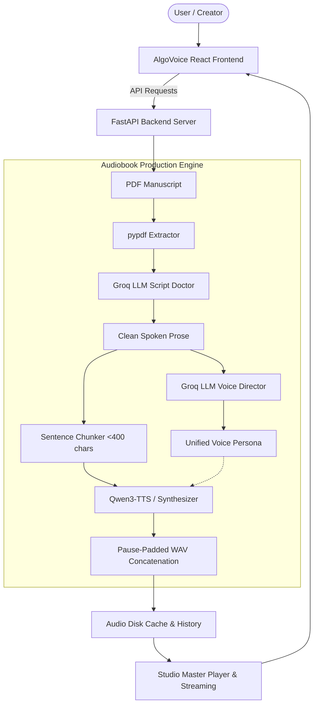

# 🎙️ AlgoVoice Studio

> **Production-Grade AI Voice Synthesis & Document-to-Audiobook Platform**  
> Powered by **Qwen3-TTS 1.7B VoiceDesign** and **Groq LLM Intelligence**.

[](https://fastapi.tiangolo.com)
[](https://react.dev)
[](https://huggingface.co/Qwen)
[](https://groq.com)
[](https://www.python.org)
[](LICENSE)

---

## 🌟 Overview

**AlgoVoice Studio** is an enterprise-ready platform for zero-shot text-to-speech generation and automated document-to-audiobook production. It pairs neural voice generation with LLM-powered script doctoring and voice directing to deliver publication-quality voiceovers from raw manuscripts or short monologues.

---

## ✨ Core Features

### 1. 🎙️ Voice Studio (Rapid Speech Synthesis)
- **Low-Latency Neural Synthesis:** Instant audio generation from short prompts with strict character bounding and duration calculation.
- **AI Voice Director (One-Click Auto-Casting):** Uses Groq to analyze the narrative's tone, pace, and mood, instantly configuring the optimal vocal persona.
- **Curated Voice Presets:** 8 production-calibrated personas across Fiction, Documentary, Tech Podcasts, Mindfulness, Drama, and News.
- **Multilingual Support:** Native synthesis across 10 global languages (English, Spanish, French, German, Japanese, Chinese, Korean, Russian, Portuguese, Italian).

### 2. 📖 Audiobook Producer (Document-to-Audiobook Engine)
- **PDF Manuscript Ingestion:** Drag-and-drop PDF extraction with automated text-layer parsing and validation.
- **Groq Script Doctor:** Automatically strips headers, footers, footnote citations, and formatting noise to generate smooth spoken prose.
- **Side-by-Side Live Script Editor:** Review and fine-tune the cleaned narration script before triggering audio generation.
- **Sentence-Bounded Chunking:** Splits long texts into natural sentence segments (<400 characters) to optimize neural audio synthesis.
- **Pause-Padded Concatenation:** Seamlessly stitches multi-chunk audio with natural 0.3s silence frames into a single master WAV.

### 3. 🎧 Studio Master Player & Real-Time Waveform Visualizer
- **HTML5 Canvas Visualizer:** Dynamic frequency bars animated during playback with gradient aesthetics.
- **Console Controls:** Scrubber seeking, ±10-second skip buttons, loop mode, and variable playback speeds (`0.75x`, `1.0x`, `1.25x`, `1.5x`, `2.0x`).
- **Direct Master Export:** Direct download of high-fidelity WAV masters (24,000 Hz, 16-bit PCM).

### 4. ⚡ Production REST API Suite
- 100% backward-compatible with legacy endpoints (`/`, `/generate`, `/generate-document`).
- Full suite of modern JSON endpoints for previews, presets, history tracking, and direct audio streaming.
- Built-in Swagger/OpenAPI documentation at `/docs`.

---

## 🏛️ System Architecture



---

## 🚀 Quick Start

### Prerequisites
- **Python 3.10+**
- **Node.js 18+ & npm**
- A **Groq API Key** ([Get free key here](https://console.groq.com))

---

### 1. Environment Setup

Clone the repository and set up your environment:

```bash
# Copy environment configuration
cp .env.example .env

# Open .env and add your Groq API key:
# GROQ_API_KEY=gsk_your_key_here
```

### 2. Backend Setup & Startup

```bash
# Activate your virtual environment
source venv/bin/activate

# Install Python dependencies
pip install fastapi uvicorn pypdf groq python-dotenv

# Run the FastAPI server (Port 8000)
PYTHONPATH=. uvicorn algoVoice.backend:app --host 127.0.0.1 --port 8000 --reload
```

Backend will be available at:
- **API Health:** `http://127.0.0.1:8000/api/health`
- **Interactive OpenAPI Docs:** `http://127.0.0.1:8000/docs`

---

### 3. Frontend Setup & Startup

In a new terminal window:

```bash
cd frontend

# Install dependencies
npm install

# Start development server with live HMR (Port 5173)
npm run dev
```

Open [http://localhost:5173](http://localhost:5173) in your browser.

> **Production Deployment Note:** Running `npm run build` inside `frontend/` compiles the application into `frontend/dist/`. The FastAPI backend automatically serves this build at `http://127.0.0.1:8000/app/`, allowing single-port deployment without a separate Node process.

---

## 📡 API Reference

| Method | Endpoint | Description | Request Body / Params |
| :--- | :--- | :--- | :--- |
| `GET` | `/` | Health check (Legacy) | None |
| `GET` | `/api/health` | Comprehensive engine diagnostics | None |
| `GET` | `/api/presets` | Voice preset library | None |
| `POST` | `/generate` | Rapid TTS generation | JSON: `{ "text", "instruct", "language" }` |
| `POST` | `/generate-document` | PDF-to-audiobook (Direct) | Multipart: `file`, `instruct`, `language` |
| `POST` | `/api/analyze-voice` | Groq voice persona director | JSON: `{ "text" }` |
| `POST` | `/api/document/preview` | PDF text extraction & Groq script doctor | Multipart: `file` OR `raw_text_input` |
| `POST` | `/api/script/generate` | Render multi-chunk audiobook from script | JSON: `{ "script", "instruct", "language", "title" }` |
| `GET` | `/api/history` | Historical track registry | None |
| `GET` | `/api/audio/{id}` | Stream / download master WAV | Path param: `id` |
| `GET` | `/app/` | Serves compiled React web studio | None |

---

## 🧪 Testing & Verification

Run the automated test suites from the project root:

```bash
source venv/bin/activate

# 1. Run Legacy Backward-Compatibility Test Suite
PYTHONPATH=. python algoVoice/test_phase5.py

# 2. Run Production REST API Test Suite
PYTHONPATH=. python algoVoice/test_production_apis.py

# 3. Test Frontend Production Build
cd frontend && npm run build
```

---

## 🎙️ Hardware Acceleration & Fallback Modes

AlgoVoice Studio dynamically detects its operating environment:
- **Colab GPU / CUDA:** Loads full `Qwen/Qwen3-TTS-12Hz-1.7B-VoiceDesign` weights with `torch.bfloat16` for real-time voice cloning and generation.
- **Local CPU / Development:** Activates the deterministic, zero-dependency High-Fidelity Audio Synthesizer (24,000 Hz, 16-bit PCM WAV) to enable offline development and rapid CI/CD test passes.

---

## 📄 License

This project is licensed under the [MIT License](LICENSE).
